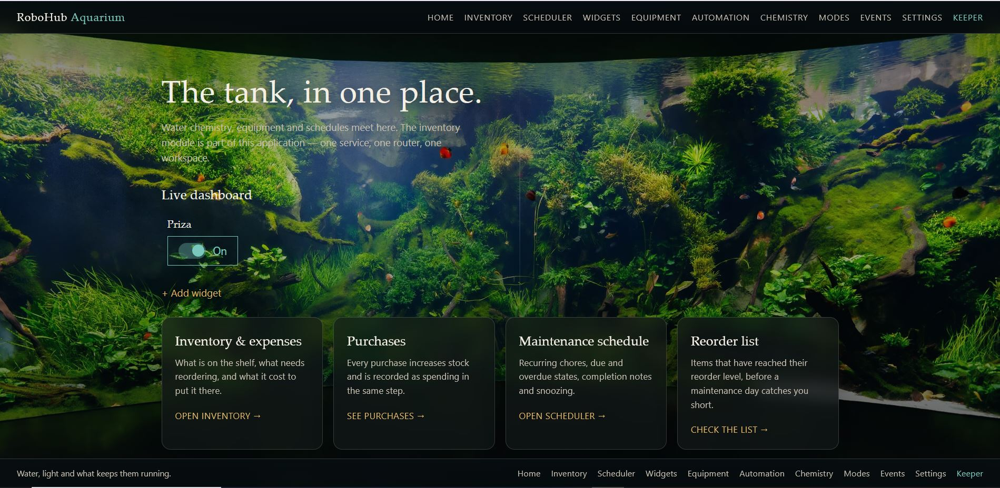
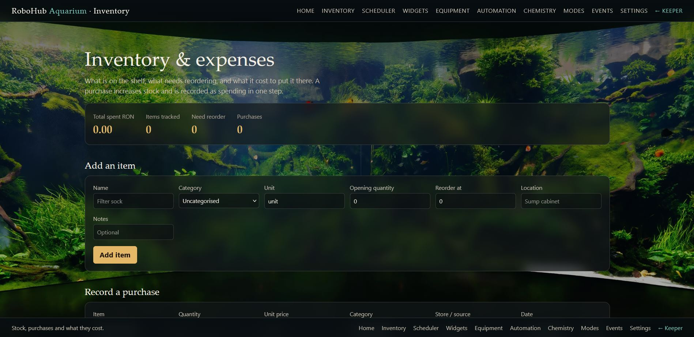
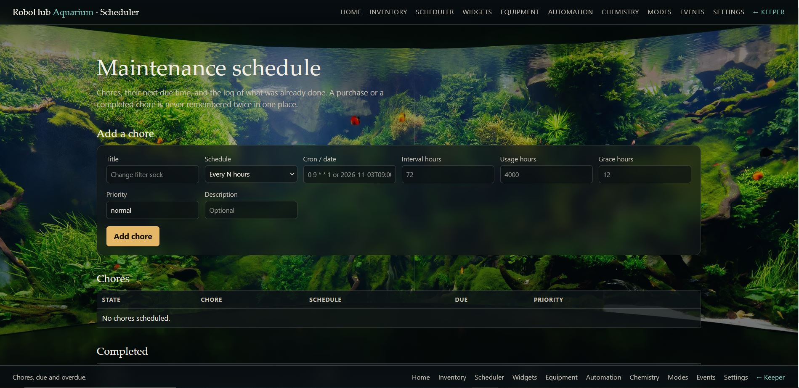
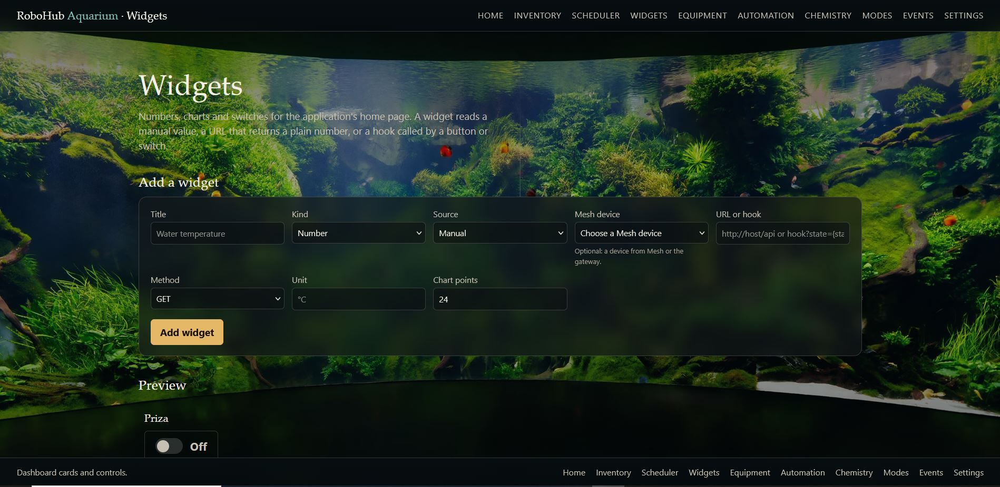

# Aquarium

The aquarium application is one HTTP service on one port. Its own domain
handlers and the reusable modules it carries register on the same router.

The modules it carries share its router, port and workspace:

- the inventory and expense tracker under `/expenses`;
- the scheduler under `/scheduler`, with its chores API under `/api/scheduler`;
- the widgets module under `/widgets`, which renders the dashboard cards on the
  home page and serves `/api/widgets`.

Each module owns its tables and pages; the application owns the router, one main
SQL database and the workspace the records live in.

## Logging

Aquarium has a Logging tab in Settings: level, text or JSON, a rotating file
under `$XDG_STATE_HOME/robohub/aquarium/`, size, retention and stderr. The
aquarium and its included modules share the app logger; standard error remains
on for journald.

## Mesh client

The aquarium registers with Mesh as a client of its project and subscribes to
`energy.fault` and `energy.mode`. Mesh delivers those messages to the
secret-authenticated callback at `/api/aquarium/mesh/events`, where an energy
fault becomes a warning toast. Registration and heartbeat use the same
`mesh-gateway` token as the rest of the gateway reads. The token is per application and per
project: generate it in Mesh project settings (Application tokens), choose its
lifetime, and copy it here. It expires; generate a new one when it does. The
token is read back from `gateway.conf` if the settings store does not have it,
and a blank token field on save preserves the existing one.

## Dashboard and equipment

The home page is a dashboard: widgets are cards, and the equipment, automation,
chemistry and mode pages are the framework the board will drive later.

- **Equipment** — devices with a state and a last value. A device can be switched
  and can report a value; the same row becomes a real pump, light or heater when
  a node binds it.
- **Automation** — rules made of a metric, an operator, a threshold and an
  action. Evaluating a value moves the rule between normal and triggered and
  writes an audit event. The rule is the policy; the hardware binding is a later
  layer.
- **Chemistry** — manual water tests (ammonia, nitrite, nitrate, phosphate, KH,
  calcium, magnesium) with value, unit, date and note.
- **Modes** — water change and feeding windows with a duration; the page is
  where they are started and where normal operation resumes.
- **Events** — the append-only audit trail of overrides, trips, modes and
  automation.

The widgets module gives the dashboard number, chart, table, button and switch
cards. A switch calls its configured hook with the new state and shows it in the
card; a table shows the latest values as rows, with the point count setting how
many rows.

All forms are cards: a semi-opaque panel over the aquarium background, with the
same colours on every module page.

## Inventory and expenses

The inventory module's pages are under `/expenses`: what is on the shelf, what
it cost and when to reorder.

## Scheduler

The scheduler's chores are under `/scheduler`, with its API under
`/api/scheduler`.

## Plug switch widget

A Shelly Plug M Gen3 registered on a gateway can be driven from the aquarium
dashboard with a **Switch** widget. In **Mesh source** choose the plug's
**Switch**; the URL, method and unit are filled from Mesh. Pressing the widget
sends `state=on` or `state=off`. The gateway polls the plug over HTTP RPC and
keeps the state and power figure.

The same plug has an input signal, **Power**, which a number, chart or table
widget can show in watts. A temperature module is an input only, so it is not
offered to a switch widget. The source list is filtered by both the widget kind
and the signal's direction.

## Settings and Mesh devices

`/settings` names the Mesh URL and the Mesh project. Aquarium asks Mesh for that
project's gateway (`/mesh/api/projects/{project}/gateway`) and stores the
returned gateway address automatically. When a widget is created or edited,
Aquarium reads the project's sources (`/mesh/api/projects/{project}/sources`)
and offers the signals of its devices, modules and sensors in the **Mesh
source** selector. Each source carries its direction, unit and the widget kinds
it can feed; the selector shows only the ones the current kind can use. A
Switch widget on a device calls the source's action endpoint with the new state,
so the plug can be turned on and off from the dashboard.

The dashboard listens to the widgets event stream, refreshes device states in
the background, and reads them before rendering, so a plug switched elsewhere is
correct both on a reload and within two seconds without one.

Charts and tables bound to a Mesh source now read the Mesh telemetry history, so
the miralis temperature chart shows a real series. Number widgets read the
latest value from the same store. No widget needs to be recreated: the provider
recognizes the Mesh value URLs the existing widgets already hold.
