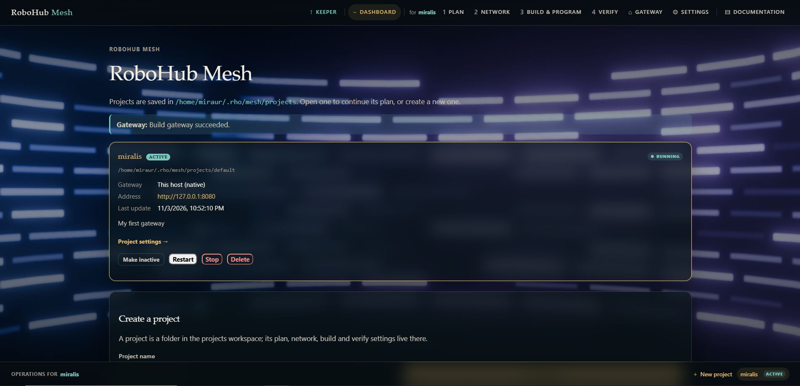
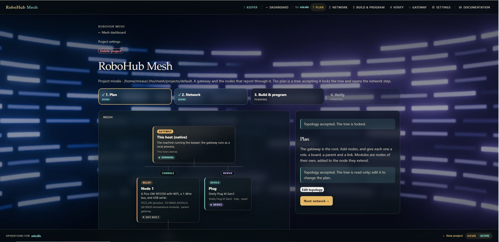
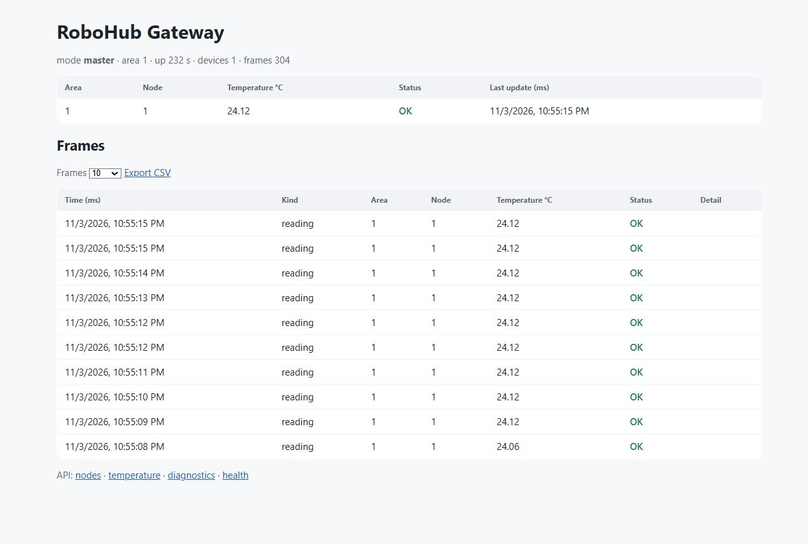

# RoboHub Mesh

The Mesh application plans and runs deployments: a gateway, the nodes that
report through it, the connections between them, and the firmware on their
boards. It is the part of the ecosystem that knows about boards, not only about
modules.

It is a keeper-hosted application: it runs on its own port, standalone or
launched from the keeper's `/applications` registry. The page is at `/mesh`; the
plan wizard for a project is at `/mesh/plan`.

The application owns its menu. The fixed top bar has Dashboard, Documentation
and, while a project is active, the operations it acts on — Plan, Network,
Build & program, Verify, Gateway and Settings — with the project named beside
them. The fixed bottom bar lists every project in the workspace, with **New
project** beside them; the active one is marked **Active** and the others are
not.

A project is made active by opening it, by **Set active** on its card, or from
its settings page. **Make inactive** clears the selection: the operations
disappear from the top bar and the bottom bar says **No active project**, while
the plan, network, build and verify pages return to the dashboard and the
projects remain listed. Creating a project when none is active makes the new
one active.

When the keeper started the application, the top bar also has **Keeper**, which
returns to the keeper that launched it.

## Projects

A mesh is saved as a **project**: a folder in a workspace.

| What | Where |
|---|---|
| Default workspace | `~/.rho/mesh/projects` |
| Override | `ROBOHUB_MESH_PROJECTS` |
| Project settings | `<workspace>/<project>/project.txt` |
| Current project pointer | `RHO_KEEPER_STATE_DIR/current-project.txt` |

A project's folder holds its plan, network, build and verify state. Renaming a
project changes its display name, not its folder; the folder is the stable
location a person can open and copy.

The dashboard lists every project with:

- its name and folder,
- the gateway recorded for it and the address it answers on,
- running / not-running status,
- the last time the gateway received a frame,
- **Restart**, **Stop** and **Delete**, and a link to **Project settings**.



**Create project** makes a new empty project and opens its plan. **Open** on a
project loads it as the current project and opens its plan. The dashboard does
not show the Plan/Network/Build/Verify steps; those belong to the project being
created or edited.

Deleting the current project selects another project; deleting the last one
leaves no active project. If the deleted project's native gateway is running it
is stopped first.

Every wizard page carries a **← Mesh dashboard** breadcrumb.

## Plan and topology



The plan is a graph of cards:

- the gateway is the root,
- every child branches from its parent,
- a device with no parent branches from the gateway beside the relay nodes,
- the branch badge is the connection and names the transport,
- each card is a frosted panel carrying the node's role and status.

A card opens the node or gateway editor. A node is one computer: a user-chosen
name, a short description, a role (`node`, `relay` or `gateway`), a board, a
parent and a link. Boards are filtered by the role.

### Nodes and modules

A node is one computer. A sensor module is a **node of its own** — `kind: module`
— attached to a node, and a node can carry any number of them. The tree shows
them as module cards under the node they extend, so the plan reads as the tree
of hardware it describes. **+ Add module** on a node card (or **+ module** in the
plan) opens the module editor.

A module node is not a build target. It has no role, board or link of its own
and is never built or programmed separately; it is carried by the image of the
node it extends. The node itself is the only thing built and programmed, and
that image carries all of its modules.

Modules are read from `robohub-drivers/boards` on every load of the editor, so a
board added to that checkout appears without rebuilding Mesh or the keeper.
Output and transceiver boards are left out — they are boards, but not sensors
fitted to a node. The list is grouped into collapsible sections by board
category, each with its own colour and three cards to a row; a section with a
module selected stays open and shows the selected name in its header. The first
module attached to a node names the example its image is built from.

A native host has no pins. The gateway can take module nodes only when it is a
real board; on a native gateway the module controls are absent, and a module
attached to a gateway is hidden if the gateway is changed back to `native`.

### Device nodes

A network device is a node of its own too. It is an integration from
`robohub-devices` — the Shelly Plug M Gen3 is the first — attached to a gateway
or a relay. A device node is never built or programmed; the node it is attached
to carries it, and the Mesh tree shows it under that parent.

The device editor chooses the integration, the transport (`http` or `mqtt`), an
HTTP address and the device id. An HTTP device can be polled and switched from
its node page; an MQTT device is carried by the relay or gateway that owns the
broker connection. A file from a device can also reach a gateway over
`POST /api/v1/frames` as an encoded RoboHub frame, so the same device record is
produced whether it arrived on a serial link or over the network.

Each module says how it reaches a bus in its own manifest:

```yaml
board:
  bus:
    type: i2c
    instance: i2c0
    address: "0x77"        # a part with one address
    addresses: "0x76-0x77" # or the range it can be configured in
    cs: auto               # SPI: the node picks a chip select
```

The node page shows a **bus plan**, which is how several modules become one
node:

- 1-Wire modules share `onewire0`.
- I2C modules share `i2c0`; two fixed addresses on the same bus conflict, and a
  module with an address range is assigned one that is free.
- SPI modules share the bus lines and each gets a distinct chip select.
- ADC, PWM, GPIO and UART instances are exclusive.

A conflict is shown on the node and that module is left out of the image, so the
parent still builds. A module that says nothing about its bus is listed without
a plan rather than guessed at.

**Accept topology** locks the tree and opens Network. **Edit topology** unlocks
it again; editing resets the network, build and verify steps that depended on
it.

## Network is about connections

Once the topology is accepted, every branch is editable as a connection. Its
transport badge opens that connection; the node card opens the node's network
page, which lists its incoming connection and the connections to its children.

A connection page shows both ends and offers only transports both boards can
serve. The set is the intersection of:

- the transports declared by the `robohub-transport` module
  (`capabilities.transports`), and
- each board's `capabilities.links`.

The transports today are UART, USB, Console, WiFi, Socket, Ethernet, RS-485, SPI
and I2C, subject to what the two boards support. `Console` is offered only when
the parent is a host — the native host or a board that declares `host` and
`console` — because the console is the host's byte stream.

The fields follow the transport:

| Transport | Fields |
|---|---|
| UART / USB / Console / RS-485 | parent endpoint, node endpoint, baud (RS-485 also its address) |
| WiFi | SSID, password, parent host, node host, TCP port |
| Ethernet / Socket | parent interface or host, node address, port |
| SPI / I2C | parent bus, node bus, address |

The gateway's own page sets the gateway host and REST port and lists its
outgoing connections. **Accept network** unlocks Build & Program; editing any
connection locks it again until it is accepted.

## Build and program

The build step is the same tree with a status on every card:

`not built`, `built`, `programmed`, `running` or `failed`.

- Clicking a node offers **Build node** and **Program node**.
- Clicking the gateway offers **Build gateway** and **Program gateway**. Program
  builds first when needed, then deploys or starts the gateway.
- The gateway page can change the gateway to another gateway board, or to
  `native` (this host). Changing it resets the network and build steps.

The node build carries the connection's transport into the firmware:

| Transport | Node link |
|---|---|
| UART | a hardware UART (`uart1` on the Pico 2W) |
| USB / Console | USB CDC |
| WiFi / Socket | the TCP sink |

The command is the one the examples use:

```sh
rho build -target <board> <node project>
rho flash -target <board> -project <node project> <image>
```

Before a Pico 2W is programmed, its page shows the boot-mode instruction and
requires the acknowledgement. The platform flash entry:

- attaches a Shared board to WSL for PICOBOOT,
- uses passwordless `sudo` when it is already available,
- re-attaches the board after the reboot into BOOTSEL,
- falls back to the bootrom's drive.

The console follows the action over Server-Sent Events. Each action has its own
progress file, so a previous run cannot replay into a new one. The console keeps
the latest line in view until you scroll away and has **Clear console**. Long
actions are not cut off by a server write or read deadline.

## Verify

Verification asks the gateway for its nodes and diagnostics:

- the gateway must answer,
- at least one reading must be present.

A native gateway is verified at `127.0.0.1`; a board gateway at the address
saved for it. If the gateway answers but no reading has arrived, the step says
so; check the connection's parent serial port and that the node is running.

## Where the lists come from

Nothing in the planner names a board or a driver that a manifest does not.

- Boards are found by scanning the local registry for platform modules and
  reading the manifests under their `boards/` directories.
- A board declares its roles and hardware in `capabilities`:

  ```yaml
  capabilities:
    gateway: true
    relay: true
    node: true
    host: false
    wireless: true
    ethernet: false
    links: "uart console usb wifi socket"
    buses: "uart usb i2c spi onewire gpio adc pwm"
    deploy: "flash"
  ```

- A driver declares what it is and how it is deployed:

  ```yaml
  capabilities:
    sensor: true
    buses: "onewire"
    measures: "temperature"

  deployment:
    boards: "pico2w"
    example: "examples/temperature/ds18b20/c/telemetry"
    binary: "build/output/telemetry.elf"
    kconfig: "CONFIG_RH_HAL_ONEWIRE=y CONFIG_RH_BOARD_DS18B20_MODULE=y ..."
  ```

- A platform board also says how a gateway is deployed to it:

  ```yaml
  deployment:
    method: "adb"          # adb, ssh, flash or process
    arch: "arm64"          # for a cross-built gateway
    kconfig: "CONFIG_RH_BOARD_ARDUINO_UNO_Q=y"
    apps_dir: "/home/arduino/apps"
    user: "arduino"        # for ssh
    path: "/home/arduino/apps"
  ```

Adding a board or a driver to the ecosystem therefore needs no keeper rebuild;
the next page load discovers it. A transport appears when both ends declare it
and `robohub-transport` lists it.

## The gateway page



The gateway's own page at `http://<gateway>:<rest>/` shows:

- mode, area, uptime, devices and frames,
- the latest values per node,
- a frame history, newest first, with selectable
  **10 / 25 / 50 / 100 / 500 / 1000** rows,
- **Export CSV** for the same window.

A node's `timestamp_ms` is its own uptime. The gateway records the wall-clock
`received_at_ms` beside it; the API and CSV keep both, and the page renders
`received_at_ms` as local date/time in the browser.

## Alerts and plugins

Mesh raises an alert when a step fails: the action, the stage and the level go
through the alert dispatcher configured in its `module.yml`. The dispatcher fans
out to the channels named in its targets; each channel has its own threshold.
The default is the local log, and e-mail, Telegram and webhook channels are
present but disabled until configured.

The alert rule engine in `contracts/alert/rule.rho` is available to application
logic that has a sensor reading: a pending window filters a spike, hysteresis
decides when the condition cleared, a cooldown recharges the rule, and a rolling
window limits repeated alerts.

## Logging

The keeper uses `rho.log` through the `logemit` port. Records carry a UTC
timestamp, a level and a subject:

```text
[2026-11-01T12:48:27.695Z] [info] [keeper] starting build_node on build
[2026-11-01T12:49:28.534Z] [info] [mesh] node 1 built
```

`RHO_LOG_FILE` also appends them to a file. The web console timestamps live
lines and the server-side is reset before each action.

## Troubleshooting

- **Gateway answers but no readings**: the board is running but its serial path
  changed. A Pico's USB CDC is renumbered by a flash; the Mesh app uses its
  stable `/dev/serial/by-id/...` path and attaches a Shared Pico to WSL.
- **Pico will not program**: put it in BOOTSEL (hold BOOT, tap RST/EN, release),
  tick the acknowledgement, and press Program. The page detects when the board
  is already in BOOTSEL.
- **FAULT temperature**: the node is heard but the sensor is not answering.
  Check the DS18B20 wiring (GP28, 3V3, GND) and its 4.7 kΩ pull-up. The node
  retries the sensor every 5 seconds.
- **The page looks stale after a rebuild**: hard-refresh the browser and restart
  the Mesh process. Templates are embedded in the binary.
- **The native gateway address**: `127.0.0.1` on the Mesh host, and the
  host's network address for another machine. The dashboard shows both.

## Tests

```sh
rho test applications/mesh
```

The Rho unit suite checks the wizard's string helpers. The smoke suite builds
Mesh, walks its pages over HTTP, saves and accepts a two-node
topology, edits a connection, creates, renames and deletes a project, checks the
locked tree, and reads the event stream.


### Gateway outage behaviour

Mesh backs off a gateway that does not answer: the delay starts at two seconds,
doubles to the configured maximum, and resets on the next successful poll. The
first failure in an outage is recorded as an actionable telemetry fault so the
fault page and Keeper loops see it without a repeated log line every two
seconds.

`GET /mesh/api/projects/{project}/telemetry/gateway` reports the backoff,
next poll time, last success, whether a fault is open, and the last error. The
maximum backoff is set in Mesh Settings → Storage.

The gateway keeps its own sequenced outbox, so a Mesh outage does not require
the gateway to discard frames; Mesh's cursor and unique key already make
repeated pages idempotent. Node-side buffering and gateway outbox retention are
the remaining store-and-forward pieces, and belong to the firmware/gateway
repositories because they run before this worker sees a frame.

## Connecting another application

A project's settings name the gateway URL that project owns. The project list is
served at `/mesh/api/projects`; a project's gateway is served at
`/mesh/api/projects/{project}/gateway`, and its devices at `/mesh/api/devices`.
Another application can point at Mesh, choose a project, and learn the gateway
automatically without storing an address of its own.

A project's signals are served at `/mesh/api/projects/{project}/sources`, and
the active project's at `/mesh/api/sources`. A source names its owner, signal,
direction (input or output), unit, the field it reads, the widget kinds it can
feed, and its value and action paths. `/value` returns a plain reading;
`/action` drives an output switch. The contract is the `signals:` list in a
device integration's or board's `module.yml`, so a new part is visible to a
dashboard without the dashboard knowing its type. A signal is listed even when
the gateway does not carry its field yet; its value is empty until the node or
device reports it.

## Application clients

An application that reads a project registers itself instead of being known to
Mesh in advance. The handshake is HTTP because the gateway provider is already
an HTTP client and the applications are separate processes; the same facts a
socket frame would carry travel in the registration.

```http
POST /mesh/api/clients/register
Authorization: Bearer <mesh service token>

{"app_name":"robohub-energy","project":"default",
 "instance_id":"energy-8482",
 "callback_url":"http://127.0.0.1:8482/api/energy/mesh/events",
 "topics":"energy.commands,grid.status.*"}
```

Mesh stores the client, the project it attached to, its callback and its
last-seen time, and returns a per-client secret.

The token that authorizes this is **per application and per project**. The
Mesh project settings page has an *Application tokens* table: generate a token
for the application name, choose its lifetime, then copy it into that
application's Mesh token setting. A project can hold several of these tokens, so
the aquarium and energy tokens are independent; rotating or revoking one does
not affect the other. A token is scoped to the project, so the application's
project list shows that project only. A deliberately broader `mesh:*` token is
an administrative choice, not the default. Every later call carries the
service token; every callback Mesh makes carries
`Authorization: Bearer <client secret>`, so an application callback is not open
to any local process.

```http
POST /mesh/api/clients/heartbeat
{"client_id":"robohub-energy-energy-8482"}

POST /mesh/api/clients/publish
{"project":"default","topic":"energy.fault",
 "payload":"South roof: back-sheet temperature above limit"}

GET /mesh/api/clients
```

`GET /mesh/api/clients` lists each client with its project, topics, last-seen
time and online flag. A client is online when its last heartbeat is less than
ninety seconds old, so a crashed application disappears without a separate
unregister.

Topic matching is exact or a trailing `.*` prefix match: `grid.status.*` matches
`grid.status.online`, and `energy.*` matches every energy topic. Publishing
routes to the clients whose project and topics match and does not send the
message to anyone else.

The aquarium registers with `energy.fault,energy.mode`; energy registers its own
callbacks and publishes faults and mode changes. The context is in the client
list, which is what Keeper uses to show who is online and which project each
application is attached to.

## Telemetry store

Mesh keeps a durable series of what the project's gateway records. The gateway
exposes a sequenced outbox; Mesh's background worker polls every project's
gateway, writes a page in one transaction, advances the cursor and acknowledges
the sequence. The unique key is `(gateway_id, seq)`, so a repeated page after a
failed acknowledgement is ignored rather than stored twice.

Mesh is the only telemetry store in the installation: applications read it
through `/mesh/api`, never by opening its file. A project's gateway may be another
service that produces readings, such as energy: the project names its
`gateway_audience`, and Mesh polls it with a short-lived service token for that
audience with the `<audience>:gateway` scope.

The store lives at `$RHO_TELEMETRY_DB` (or `$ROBOHUB_MESH_TELEMETRY_DB`), or
`~/.rho/mesh/telemetry.db` when neither is set. It is SQLite in WAL mode
with a series index, a latest-value table and one-minute and hourly rollups.
Raw readings are kept for the project's `telemetry_retention_days` (30 by
default); minute rollups are kept for 180 days and hourly rollups for five
years, so an old range still has a series. A project's `gateway_token` is the
bearer token its gateway requires, and `ROBOHUB_GATEWAY_TOKEN` is the fallback
for a deployment that uses one token everywhere. The schema is
`db/schema.sql` and the host half is the `telemetry` port.

An application reads it through the gateway contract, or directly through Mesh:

- `GET /mesh/api/projects/{project}/telemetry/status` — rows, newest time and
  gateway count for the project.
- `GET /mesh/api/projects/{project}/telemetry/latest?source=<source>`
- `GET /mesh/api/projects/{project}/telemetry/series?source=<source>&from=<ms>&to=<ms>&step=<ms>`
  — raw readings when `step` is absent or zero, averaged into buckets otherwise.

A source is the same ID `/sources` publishes (`device.3.power`,
`module.2.temperature`). That ID is unique within a project, but it is not the
identity a stored series is keyed on: the object also carries `module_id`
(the device integration or board), `driver_id` (the driver that produces the
signal, when one does), `source`, `project` and `instance`. `source` is
`<driver_id or module_id>.<signal.id>` and `instance` is `area:node`, so two
modules with the same name in different repositories, or two instances of one
module, are different series. Its object carries `history_path` and, when Mesh
knows its own origin, `history_url`, so a dashboard can ask for a chart without
knowing the area, node or field the reading was stored under.

Mesh records the URL of a native or SSH gateway it starts in the project's
`gateway_url`, and passes the gateway its tree position (`GATEWAY_MODE`) and
`GATEWAY_AREA`, so a project's gateway and the project's plan agree. A gateway
reached over ADB still needs its address set in the project. A network device's
readings are stored under the id the gateway assigned it; a device source is
matched to that id by the name and address in the plan, so its chart does not
need to know the gateway's numbering.

## Building a node from modules

A node is built from the modules in the plan, not from one driver's example.
Mesh copies the telemetry node template, writes `src/sensors.c` from the
descriptors in `robohub-drivers`, adds every compatible module and its driver
to the build, writes the Kconfig the board and modules need, and builds the
image for the node's board.

The descriptors are the contract:

- a driver names its device type and one `signal|field|unit|type|member|read|output`
  line per readable signal under `telemetry_fields:`;
- a board module names its BSP header and entry point under `telemetry:` and
  carries the signals it exposes under `signals:`.

The generated field is `m<node-index>.<field>`. Two modules that both measure
temperature on one node therefore become two series, and the source ID the
application already uses (`module.3.temperature`) resolves to the right one.
The source object also names the board (`module_id`) and the driver
(`driver_id`), which is what makes the series identifiable when two
repositories use the same module name.

Every board module in `robohub-drivers/boards` appears in the picker, including
relays and transceivers. A module with no read path is linked and configured
but contributes no reading. The dual-axis joystick is the one board whose
descriptor is not yet expressible, because it presents two analog axes and a
button through three separate init calls.

## Device telemetry

Devices from `robohub-devices` are described the same way as drivers: each
manifest names the interface it presents and, for an HTTP device, the path to
read and one line per signal.

- **HTTP devices** — the Shelly plug and a Hoymiles through an OpenDTU — are
  polled by Mesh's background worker. The response is read by JSON path, scaled
  to the unit the signal declares, and written to the telemetry store under the
  device node's plan identity: project area and node index.
- **Modbus and GPIO devices** — a Growatt or a relay — are carried by a device
  node (`robohub-devices/nodes/gateway-node` or a composed application). That
  node publishes `AREA` and `NODE` from the plan; the device page shows the two
  values, and the gateway outbox turns the frame into one series per signal.

A device source (`device.3.pv_power`) resolves to the same area, node and field,
so a chart and the live value read the same series. The device page's Poll
button uses the same descriptor as the background poller; it is not Shelly-only.
Switch actions appear only for a plug, switch or actuator, so an inverter does
not offer a meaningless switch button.
## Scope enforcement

Every `/mesh/api` handler verifies the authenticated token's audience and
project scope. A service token must carry `mesh:<project>`, `mesh:*`, or `*`;
a browser session behind the keeper is exempt. Mint a scoped service token with
`rho auth ticket --scopes mesh:default`. A token that was revoked is refused
without consulting the keeper: the middleware reads the same `revoked.txt` the
`rho auth revoke --jti` command writes.
