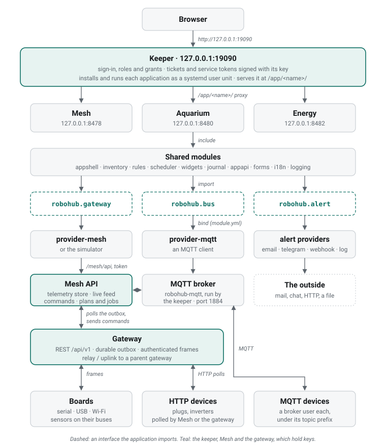

# How it fits

RoboHub is a handful of programs on one machine and a tree of gateways and
boards around it. Each layer knows only the one below it, through a named
interface, so a part can be replaced without the others noticing.

## From the top

**The browser** talks to one address: the keeper, `127.0.0.1:19090`.

**The keeper** signs people in and holds the only signing key. It installs the
applications, runs each as a systemd user unit on its own loopback port, and
serves them at `/app/<name>/` on its own origin, so one address — and one TLS
proxy, if there is one — reaches all of them. See {ref}`keeper/index`.

**The applications** — Mesh, Aquarium, Energy — are each one HTTP service on
one port. An application is mostly shared modules: it includes them, they
register their routes on its router, and it defines a few `host_*` functions
that make them its own ({ref}`build/host-application`).

**The interfaces** are how an application reaches anything outside itself:

| Interface | For | Providers |
|---|---|---|
| `robohub.gateway` | sources, readings, history, the live feed, switching an output | `robohub-provider-mesh`, the `simulator` |
| `robohub.bus` | MQTT topics | `robohub-provider-mqtt` |
| `robohub.alert` | an alert on every channel the application binds | `robohub-provider-email`, `-telegram`, `-webhook`, `-log` |

An application lists the providers in `bind:` in its `module.yml`; only those
are compiled in, and its Settings page changes their configuration on a running
installation.

**Mesh** is an application and the one owner of telemetry. Through its API
(`/mesh/api`) the other applications read sources, history and the live feed and
send actions; behind it, Mesh plans each mesh, builds and flashes its boards,
runs its gateway and polls it. See {ref}`mesh/index`.

**The gateway** is the edge. It reads authenticated frames from boards over
serial, USB or Wi-Fi, polls network devices, keeps a durable outbox of readings
for Mesh, and answers commands. A gateway can run as a relay that reports through
a parent gateway's uplink. See {ref}`robohub-gateway/index`.

**Boards and devices** are the hardware: boards running RoboHub firmware with
sensor modules on their buses, and network devices — plugs, inverters — reached
over HTTP or through the keeper's MQTT broker.

## Ports

| What | Listens on |
|---|---|
| Keeper | `127.0.0.1:19090` |
| Mesh, Aquarium, Energy | `127.0.0.1:8478`, `:8480`, `:8482` — or the next free port from 8500 |
| MQTT broker (`robohub-mqtt`) | `127.0.0.1:1884`, or every interface when opened for devices |
| A mesh's gateway | its REST port and uplink port, given by Mesh per mesh |

## More

- {ref}`architecture/reading` — one reading from a sensor to a widget or a rule.
- {ref}`architecture/enrollment` — how boards and nodes get an identity.
- {ref}`architecture/security` — sign-in, tokens and scopes, the proxy,
  isolation.
- {ref}`The firmware stack <architecture/stack>`, {ref}`networking on a board <architecture/networking>` and
  {ref}`secure telemetry <architecture/secure-telemetry>` — the design underneath.
