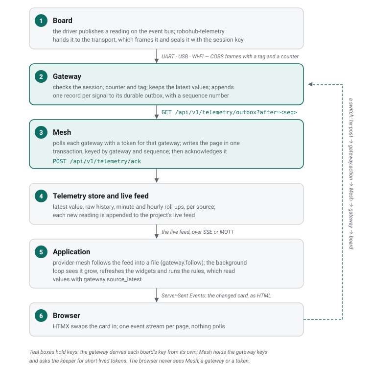

# The path of one reading

A temperature sensor on a board, a card on the aquarium's dashboard that shows
it, and a rule that switches the heater off when it is too warm. This page
follows the reading the whole way, and the command back.



## 1. On the board

The sensor's driver publishes the reading on the board's event bus
(`robohub-core`); it names no transport. `robohub-telemetry` is subscribed to it
and writes it to every enabled sink. `robohub-transport` turns it into a frame —
a six-byte header, the payload and a check, COBS-encoded and `0x00`-delimited —
and, because the board has a session with its gateway, seals it with a session
id, a counter and a tag. The link writes the bytes: a UART, USB CDC or a TCP
socket over Wi-Fi, whichever Mesh planned.

The payload is the packed struct a `rho protocol` schema generates, so the
gateway decodes the same bytes into the same value. Which fields a board can
report is in its manifest (`telemetry_fields`, `signals`), and Mesh generated
the board's sensor table from it when it built the image. See
{ref}`the firmware stack <architecture/stack>`.

## 2. At the gateway

The gateway drops a frame whose session is unknown or expired, whose counter is
not greater than the last one, or whose tag does not match
({ref}`secure telemetry <architecture/secure-telemetry>`). An accepted reading updates the
board's latest values and is normalized into one record per signal —
`{seq, source, area_id, node_id, field, value, status, received_ms}` — appended
to a durable outbox with a sequence that continues across restarts. The outbox
is synced in batches, so an eMMC card sees few writes, and bounded by
`OUTBOX_MAX_ROWS` when nobody collects it.

A network device the gateway polls, such as a Shelly plug, goes into the same
outbox under the gateway's own device id.

## 3. Into Mesh

Mesh's background worker polls every mesh's gateway:

```text
GET  /api/v1/telemetry/outbox?after=<seq>&limit=<n>
POST /api/v1/telemetry/ack   {"seq": n}
```

Each request carries a short-lived token the keeper issued for the audience
`gateway`, scoped to that gateway alone (`gateway:<mesh>:*`). Mesh writes the
page in one transaction, keyed by gateway and sequence — so a page fetched twice
is stored once — and then acknowledges it, which lets the gateway prune.

The store is Mesh's alone: SQLite in WAL mode with the latest value per source,
raw history (thirty days by default), one-minute roll-ups (180 days) and hourly
roll-ups (five years). It is built into Mesh as a Go port, the `mesh-telemetry`
plugin in Mesh's repository. A reading is kept under its **source** — the
planned node's id and the signal, such as `ba06f37ca34ba32c.temperature` — so it
keeps its history when the plan is reordered.

Mesh polls HTTP devices itself, and reads MQTT devices from the broker, as the
broker user the keeper made for it; both end in the same store.

Every new reading is also appended to the mesh's **live feed**.

## 4. Into the application

The aquarium reads Mesh through the `robohub.gateway` interface and the
`robohub-provider-mesh` provider it binds. Its widgets module asks the provider
to follow the live feed (`gateway.follow`), which the runtime keeps open for as
long as the application runs, writing it to a file:

- over HTTP, `/mesh/api/projects/<mesh>/telemetry/stream`, a Server-Sent Events
  stream that starts with a snapshot of the current values;
- or over MQTT, the topic `mesh/<mesh>/telemetry`, which Mesh relays the same
  feed to when the installation runs the broker.

The binding's `transport` setting chooses: `auto` (the broker when there is
one), `bus` or `http`. Either way the application's requests carry a service
token for the audience `mesh`, scoped to its mesh, which the runtime fetches
from the keeper with the credential the keeper started it with.

The aquarium's background loop checks every half second whether the file grew.
When it did:

- **the widgets** are refreshed: each card whose value changed is rendered again
  and written to the dashboard's event file;
- **the rules** run. A rule names equipment by role — `heater.temperature` — and
  the inventory resolves the role to the bound source and asks
  `gateway.source_latest`. When a condition holds past its wait, the rule acts,
  writes to the journal and, when the application binds `robohub.alert`, raises
  an alert.

Rules also run every five seconds without a reading, so a wait or a cooldown
ends on time.

## 5. In the browser

The dashboard page holds one Server-Sent Events connection to the aquarium.
It receives the changed card as HTML and HTMX swaps it in; a page that
reconnects receives a snapshot first. Nothing in the browser polls, and nothing
in it ever talks to Mesh or a gateway or sees a token. See
{ref}`build/reactive-ui`.

## The way back: a command

A switch on a card, or a rule's action, is `gateway.action(source, "on")` in
the application. The provider posts it to Mesh:

```text
POST /mesh/api/projects/<mesh>/sources/<source>/action?state=on
```

Mesh brokers it to what carries the source — the gateway, or the device's own
HTTP or MQTT interface — and the new state comes back the way every reading
does. Nothing in the page assumes the switch worked until
it does.

## When a part is missing

| Missing | What happens |
|---|---|
| The gateway is down | Mesh's fleet shows that it does not answer; the store keeps the history it has, and a chart shows the gap |
| Mesh is down | the gateway's outbox keeps readings up to `OUTBOX_MAX_ROWS`, and Mesh collects them when it is back |
| No mesh at all | the application's Settings → Gateway switches to the simulator, which serves the devices in its `presets/sim.yml` |
